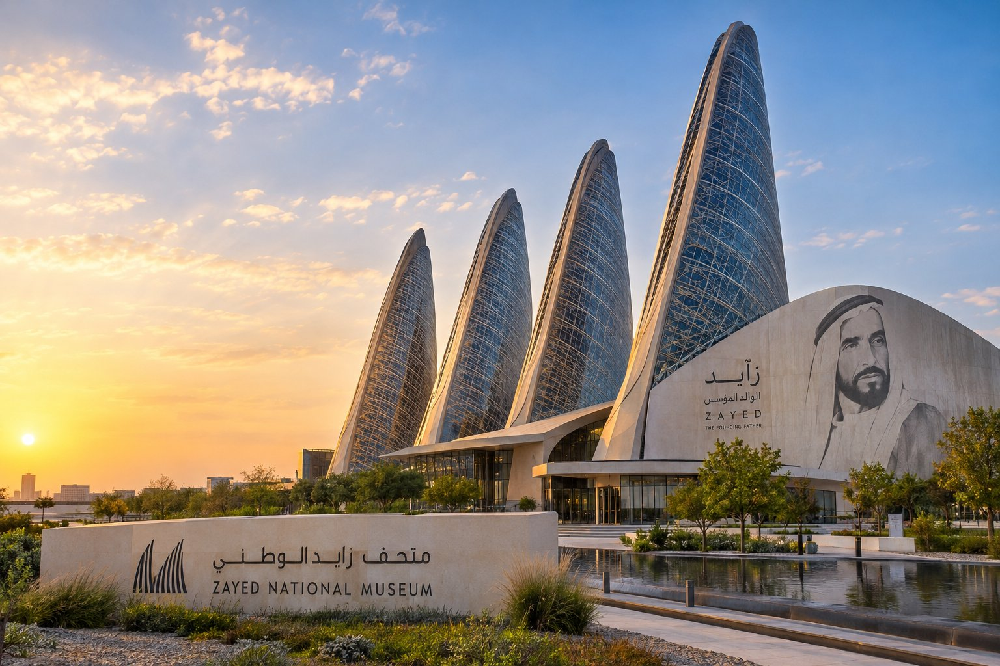

# Zayed National Museum Abu Dhabi: Discover the Story of the UAE's Heritage and Vision

*Zayed National Museum on Saadiyat Island, Abu Dhabi.*

Abu Dhabi is a city that rarely stands still. Glass towers keep rising along the Corniche, new districts appear on former sandbanks, and yet the capital has been working just as deliberately on something less visible: how to tell the story of where it came from. Nowhere is that clearer than on Saadiyat Island, where Zayed National Museum Abu Dhabi opened its doors on 3 December 2025, the day after UAE National Day.

As the national museum of the United Arab Emirates, it does something few attractions manage. It places a single life, that of the country's founding father, at the centre of a much larger story about land, sea, trade and belonging. For anyone looking for things to do in Abu Dhabi that go beyond shopping malls and skylines, it is one of the most meaningful places to spend an afternoon.

## The Man Behind the Museum

The museum is named for Sheikh Zayed bin Sultan Al Nahyan, who ruled Abu Dhabi from 1966 and became the first President of the UAE when the seven emirates united in 1971. He held that office until his death in 2004. Emiratis know him simply as the Founding Father, and understanding why helps explain the whole museum.

Zayed's reputation rests on a few consistent themes: a belief in unity among the emirates, investment in education and health, and a deep attachment to the desert, its wildlife and its traditions. His famous campaign to green the desert, with farms, parks and millions of trees, remains one of the most visible parts of that legacy. Foster + Partners describe the museum as telling the story of his creation of the Emirates and the many facets of what he left behind, including that vision of a greener land.

If you are searching for Sheikh Zayed history in a form that is easy to absorb, this is a good starting point. The museum treats his life as a lens, a way into the values that shaped the nation rather than a simple biography.

## Zayed National Museum Architecture: Wings Over Saadiyat

You can see the building long before you reach it. Five steel towers rise above the site, shaped to evoke the wings of a falcon in flight. The falcon is a national symbol and falconry was a practice close to Sheikh Zayed's heart, so the reference is personal as well as cultural. The architects, Foster + Partners, won the design competition in 2007, and the project took roughly fifteen years to reach completion. Project descriptions put the tallest towers at about 123 metres.

The wings are not purely decorative. They work as solar thermal chimneys, drawing cool air through the building as part of a passive cooling strategy, a modern take on the wind towers that once ventilated traditional Gulf homes. The glazed wings also channel natural light into the spaces below. According to Foster + Partners, the galleries sit within a mound whose form abstracts the topography of the Emirates, and pod-like galleries are suspended beneath four of the five wings, appearing to float within the space.

The result is a building that reads as both landscape and sculpture. It also earned international attention: the museum has since been named in the 2026 Prix Versailles selection of the world's most beautiful museums, the only Gulf institution on that list.

## Inside the Galleries

The visit begins outdoors. Al Masar Garden, a 600-metre outdoor gallery planted with native species, introduces the landscapes that inspired Sheikh Zayed before you step inside. From there, six permanent galleries move through the story of the country. According to the museum's opening materials, the permanent displays hold more than 1,500 objects, combining archaeological finds, historic items, audiovisual and sensory experiences, contemporary installations and reconstructions.

The galleries are organised by theme rather than strict chronology:

- **Our Beginning** explores Sheikh Zayed's life, values and the formation of the federation.
- **To Our Ancestors** looks at human activity in this region stretching back some 300,000 years. The museum's showpiece here is a stone tool of that age found at Jebel Hafit in Al Ain.
- **Through Our Connections** examines trade and exchange with other civilisations, along with the development of Arabic and the spread of Islam.
- **By Our Coasts** turns to pearling, fishing and maritime commerce, and how life by the sea shaped Emirati identity.
- **To Our Roots** digs into daily life, customs and traditional practices.
- **Through Our Nature** considers the country's varied environments and the sustainable habits that developed within them.

There is also a temporary exhibition space. Local press has reported on a show exploring the camel's 7,000-year history in the region, though programming changes, so it is worth checking what is on before you go.

## What Visitors Can Learn

Many visitors arrive knowing the UAE through its present: the skylines, the airlines, the ambition. The museum's contribution is depth. It shows that this land has been inhabited for hundreds of thousands of years, that pearl divers and traders connected its coast to distant markets, and that the desert and the sea demanded cooperation long before anyone drew a national border.

It also makes a case for continuity. The hospitality customs, the oral traditions of poetry and song, the respect for nature: these appear in the galleries as living threads rather than relics. The museum's programme has included traditional dances, coffee-serving ceremonies and craft workshops, which suggests heritage is meant to be experienced as well as observed. For anyone curious about UAE national heritage, that framing is the most useful takeaway.

## Location and Surroundings: The Saadiyat Cultural District

The museum is the centrepiece of the Saadiyat Cultural District on Saadiyat Island, a short distance off the main Abu Dhabi island. The district is home to several of the best-known Abu Dhabi museums. Louvre Abu Dhabi, with its vast perforated dome, stands nearby, and the newer Natural History Museum Abu Dhabi and teamLab Phenomena Abu Dhabi opened in the same cultural season as Zayed National Museum.

Taken together, they make Saadiyat one of the most concentrated clusters of cultural attractions in Abu Dhabi, covering art, natural science, digital installation and national history. Each has a distinct character, so they complement one another rather than repeat themselves.

## Practical Visitor Information

The details below come from the museum's opening announcements. Prices, hours and policies can change, so please confirm everything on the official website, [zayednationalmuseum.ae](https://zayednationalmuseum.ae), before you travel.

### Opening Hours

At launch, the museum was open daily from 10:00 am to 8:00 pm, with last entry one hour before closing. Tickets are sold in timed slots, so booking ahead is sensible.

### Zayed National Museum Tickets

General admission at launch was AED 70 for adults, with students and teachers paying AED 35. Children under 18 and senior citizens were admitted free. Annual memberships are also offered. Because ticket categories and prices may have been updated since opening, treat these figures as a guide and check the official ticketing page.

### Accessibility and Facilities

The museum joined the Hidden Disabilities Sunflower programme, which allows visitors who may need extra time or support to wear a sunflower lanyard or pin so trained staff can offer assistance. On-site dining includes the Emirati restaurant Erth and Al Ghaf Cafe, and there is a museum shop, Al Nagwa Boutique. Modest clothing covering shoulders and knees is advised.

### Photography and Visit Duration

We could not find a confirmed, current statement on photography rules or a recommended visit length, so please check the museum's website or ask on arrival rather than rely on assumptions. As a general planning suggestion, a museum of this scale, with a garden and six galleries, rewards an unhurried visit of a few hours.

## Planning a Visit to the Museum

Start by checking opening times and booking a slot. Mornings and weekdays are typically calmer at major museums, though that is a general observation rather than museum-specific data. Allow time for Al Masar Garden, particularly in cooler months when walking outdoors is pleasant, and leave room for a meal at one of the on-site cafes.

If you want to combine attractions, one sensible approach is to give the museum the main part of your day and add a shorter visit to a neighbouring venue in the late afternoon or evening. Trying to cover several Saadiyat institutions in one go tends to dilute each experience.

## Getting There

Zayed National Museum is on Saadiyat Island, reached by road from central Abu Dhabi, the airport and Yas Island. Visitors commonly use metered taxis or ride-hailing apps, and Abu Dhabi's public bus network serves parts of the island, though routes and frequencies change, so check current timetables. Some travellers prefer a pre-arranged private chauffeur, for example through a company such as Private Hire Limousine, particularly when travelling with family, luggage or a tight schedule. Whichever option you choose, allow extra time during peak traffic and confirm the drop-off point for the museum entrance.

### Choosing How to Travel

| Option | Best for | Worth knowing |
| --- | --- | --- |
| Taxi or ride-hailing | Solo travellers and couples | Fares and waiting times vary with demand, especially at busy hours |
| Public bus | Budget-conscious visitors | Routes and frequencies change, so check current timetables |
| Pre-booked private chauffeur | Families, groups, luggage, airport arrivals, fixed schedules | Arranged in advance; waiting time or a multi-stop day can be agreed with the operator |

### Coming from Dubai

Many visitors stay in Dubai and make Abu Dhabi a day trip. The drive to Saadiyat Island is typically more than an hour each way, depending on where you start and the traffic, so a direct door-to-door transfer saves the logistics of changing between metro, bus and taxi. If you are travelling with children or have a timed museum ticket, building in a generous buffer is wise.

### A Sample Day on Saadiyat

One way to shape the day, if you want to see more than one venue without hurrying:

1. Morning pickup from your hotel or the airport, arriving around opening time at 10:00 am.
2. Explore the galleries and Al Masar Garden at an unhurried pace.
3. Lunch at Erth or Al Ghaf Cafe inside the museum.
4. Afternoon visit to a neighbouring Saadiyat venue, such as Louvre Abu Dhabi.
5. Return transfer to your hotel, or onward to dinner.

If you would like a transfer arranged for a day like this, you can request a transfer quote from [Private Hire Limousine](https://privatehirelimousine.com/#book).

## Frequently Asked Questions

**How do I get to Zayed National Museum from Dubai?** By road, the museum is typically more than an hour from most parts of Dubai. Options include a taxi, ride-hailing, intercity bus plus a local connection, or a pre-arranged private transfer.

**Can I book a driver to wait while I visit?** Many private transfer operators can arrange waiting time or a return pickup. Confirm the terms when you request your quote.

**What are the Zayed National Museum opening hours?** At launch, the museum opened daily from 10:00 am to 8:00 pm, with last entry one hour before closing. Check [zayednationalmuseum.ae](https://zayednationalmuseum.ae) for current hours.

**How much are Zayed National Museum tickets?** General admission was AED 70 for adults at launch, with reduced and free categories. Check the official website for current prices.

## Why Zayed National Museum Abu Dhabi Matters

It would be easy to treat a new national museum as one more stop on a sightseeing list. But Zayed National Museum Abu Dhabi asks for something slightly different from its visitors: attention to how a country understands itself. Its galleries trace a long arc from ancient toolmakers to a modern federation, and its architecture turns a beloved bird of the desert into a statement about sustainability and identity.

For residents, it offers a shared story. For visitors, it offers context that makes every other part of the UAE easier to read, from the old forts and souks to the towers on the skyline. That is the real value of the museum: it helps you see that the Abu Dhabi of today did not appear from nowhere, and that its aspirations are rooted in values with a long history.
